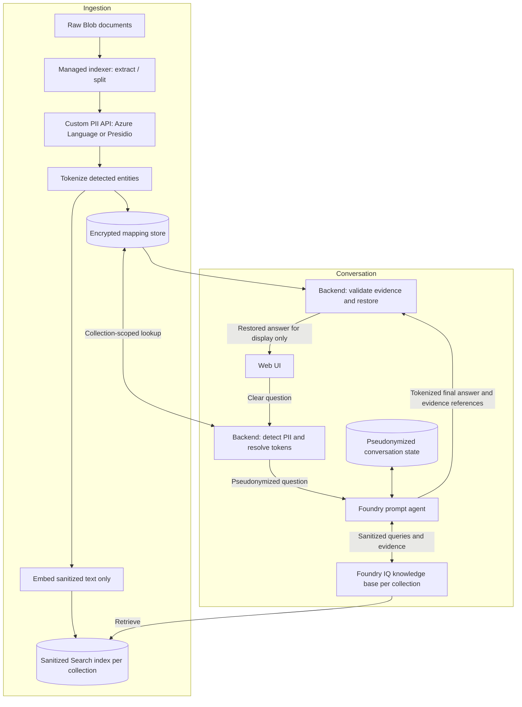

# Privacy-preserving RAG on Azure: architecture and sample plan

Research date: 20 November 2026. The broader design below includes proposed future capabilities. The implemented subset has since been deployed and live-tested; use [README.md](README.md) for the current two-demo guide and [LIVE_TEST.md](LIVE_TEST.md) for dated validation evidence.

Scope: PII detection, pseudonymization, and authorized restoration on standard Azure services. Confidential computing, trusted execution environments (TEEs), hardware attestation, and confidential compute SKUs are out of scope.

## Implemented lean slice

There are now two independent demonstrations: **Demo 1**, a standalone file-list/directory script calling Azure PII (or Presidio) and writing irreversible category-redacted files without a vault; and **Demo 2**, the RAG flow below. Both use eight physical synthetic files covering names, addresses, emails, phones, cards and example government/bank IDs. No external-party integration is modeled.

The runnable implementation is documented in [README.md](README.md). It focuses on technical support incidents, similar failure patterns, and policies with **incidental** PII. Questions redact detected identifiers without identity resolution; technical terms drive retrieval. The Foundry prompt agent calls Foundry IQ through a backend-executed function, which fixes collection routing and captures restoration evidence. No MAF/custom hosted-agent runtime is used.

The UI is dependency-free HTML/CSS/JavaScript served by FastAPI rather than React/TypeScript, to keep setup lean. The encrypted mapping store is SQLite/Fernet for a single persistent replica. Existing-resource provisioning is a Python command, not Bicep. English text is limited to 4,000 characters/document. An explicitly labelled synthetic-only local extractive mode is included; it does not simulate an Azure/LLM connection.

An Azure CLI-backed deployment script now provisions the application infrastructure, private Blob routes, identities, Search objects and agents, reusing an existing Foundry/model account. The sections below retain the broader design and future evolution options. Identity lookup, Search-index migration, PDF/OCR, source-deletion automation, distributed storage and per-document permissions are not implemented. README describes current behavior and limitations where the broader plan differs.

MVP decision: separate collections by Search index, with a matching Foundry IQ knowledge base per collection. Document-level RBAC/ACLs and per-entity reveal roles are deferred. Standard service authentication remains required; index separation alone is not an authorization boundary.

## 1. Recommendation

Build a privacy gateway around retrieval and generation, with two interchangeable PII detectors: Azure Language first, then a self-hosted Presidio API. Use a shared, application-owned tokenization and restoration service for both.

Default to **reversible pseudonymization**, not "anonymization": a system that retains the ability to identify people still processes personal data. Masking alone cannot support restoration. Pseudonymized text can also reveal people through context, so it remains protected content.

Deliver two ingestion profiles:

1. **Default managed-skillset profile:** a Blob indexer and PII custom skill publish sanitized chunks and embeddings into a dedicated collection index. Native source-permission ingestion is disabled.
2. **Optional strict pre-Search boundary:** preprocess raw files outside Search and expose only sanitized content to Search, using push ingestion or a managed indexer over sanitized staging.

Use a Foundry prompt agent connected to Foundry IQ. The agent manages system instructions and pseudonymized conversation state. No Microsoft Agent Framework or custom hosted-agent runtime is required. Include a web UI for ingestion, chat, citations, and a synthetic-data privacy inspector.

## 2. Findings that determine the architecture

| Question | Finding and design consequence |
| --- | --- |
| Can managed Search indexers detect PII? | Yes. The built-in `PIIDetectionSkill` returns entity text, types, confidence, offsets, and optionally character-masked text. It does not provide a reversible token vault. [1] |
| Can a custom skill call Azure Language or Presidio? | Yes. A Web API skill can call an HTTPS endpoint, including an Entra-protected endpoint using Search's managed identity. The endpoint must implement the Search skill request/response contract. [2] |
| Does deferring document RBAC unblock custom skills? | Yes: do not enable native Blob permission ingestion in the MVP. Its custom-skill incompatibility remains a future migration consideration, not an MVP blocker. [3] |
| Is index separation sufficient by itself? | It separates retrieval data, not caller privileges. The backend fixes the permitted index/knowledge-base route; browsers and model tools cannot supply arbitrary resource names. Service identities may still have broader access. |
| Can Azure PII restore masked values? | Its documented interface detects/redacts; there is no documented inverse service that reconstructs removed values. Retain protected mappings if restoration is required. Newer synthetic/entity replacement options must not be confused with a durable reversible mapping service; synthetic replacement is documented as preview. [7] |
| Does Presidio solve reversibility? | Its encrypt/decrypt operators support reversible transformations, but state, keys, authorization, entity identity, and LLM-output token preservation remain application responsibilities. Generic replacement and hashing cannot be inverted. [8] |
| Can Search index another Search index directly? | Search indexes are not listed as a supported indexer data source. Use an application export/push migration or return to the original source. [11] |
| Can Foundry IQ use sanitized content? | Yes: connect a knowledge source backed by the existing sanitized Search index. Sanitize questions/history before any optional query-planning LLM sees them. Each MVP knowledge base references only its collection's sanitized index. [9] |
| Can Microsoft Agent Framework and hosted agents be used? | Yes. Agent Framework supports Foundry IQ agentic retrieval. It can run in the application or in Foundry hosted agents; hosting does not replace query sanitation or final restoration. Check preview dependencies before implementation. [10][12] |

## 3. Trust boundaries and components

### Sensitive processing zone

- Raw Blob Storage, inaccessible to the chat client and generation identity.
- Extraction/OCR worker where strict pre-Search protection is required.
- PII API with Azure Language and Presidio detector adapters.
- Tokenization service and encrypted mapping database.
- Query-PII resolution service, collection router, and final-response renderer.

Azure Language receives plaintext when selected. That is an explicit trust decision. A self-hosted Presidio deployment can keep detection inside customer-controlled compute. Both options use standard Azure compute and retain the same application-level access controls.

### Sanitized retrieval and reasoning zone

- Separate Search index per collection, containing sanitized text and embeddings generated only from that text.
- Azure OpenAI model deployment for generation.
- Foundry IQ knowledge base per collection over its sanitized index.
- Foundry prompt agent with sanitized retrieval context and pseudonymized conversation state only.

No mapping values, raw entity spans, clear-text PII, or reversible encryption keys are returned to this zone. "No PII" is a target verified against a labeled dataset, not a guarantee of perfect detection.

### Delivery zone

- Backend uses a server-configured collection route; no document-level permission checks in the MVP.
- Renderer restores only evidence-backed token references from the active collection after the final model invocation, when restoration is enabled for that collection.
- Browser receives the permitted clear-text result; that disclosure is intentional.
- Source viewer resolves citations only inside the active collection and shows sanitized content by default; do not return raw Blob SAS URLs.

Use managed identities, least-privilege roles, private networking where supported, encryption, and payload-free telemetry. Confirm each actual indexer outbound path: a private endpoint on an API alone does not establish Search-to-API connectivity.

## 4. Ingestion designs

### A. Managed Blob indexer plus custom skill

Processing sequence:

1. Search's managed identity reads raw Blob content.
2. Document cracking and, if needed, OCR produce text.
3. Text is divided into detector-sized analysis windows with boundary handling.
4. An Entra-authenticated custom Web API skill calls the selected detector, normalizes spans, tokenizes the PII, and commits encrypted mappings.
5. Final retrieval chunks are produced from sanitized text.
6. Embeddings are generated from sanitized chunks.
7. Index projections publish only sanitized text, safe metadata, collection ID, and immutable source/version references into the collection's index.

This protects the final index and model inputs; it does **not** prevent the Search ingestion service from processing raw PII. Built-in OCR or other upstream services may also see raw data.

For an Azure-first educational variant, use the built-in PII skill's `piiEntities` output followed by a custom tokenizer skill. Do not persist the entity output. A single custom adapter calling Azure Language directly provides cleaner Azure/Presidio interchangeability.

Do not configure native source-permission ingestion or document security filters for this MVP. Bind each collection server-side to its Blob container/prefix, indexer, skillset, sanitized index, knowledge base, and mapping namespace. Reject unknown collection routes. An index name supplied by a browser, prompt, or source document is never routing authority.

The built-in PII skill has a 50,000-character record limit and can warn/truncate oversized inputs. Do not treat successful HTTP execution as proof of full protection. Reject/quarantine missing outputs, unsupported languages, incomplete coverage, and relevant warnings. [1]

### B. Future document-permission evolution (deferred)

Keep stable collection/document/version references so future releases can add authoritative ACL metadata, delegated-user retrieval, and reveal policies. Reassess native push ACL ingestion or application filtering then; do not implement either in the MVP. Native Blob permission ingestion cannot simply be switched on alongside the custom skill. [3][5][6]

### C. External protection plus sanitized staging and managed indexer

Use when managed scheduling/indexing is important but raw data must not enter Search:

1. Protect data in an external worker.
2. Write sanitized text and safe metadata to a separate staging container.
3. Index the sanitized staging content using supported managed indexer settings.

Keep staging, index, knowledge base, and mapping namespaces collection-scoped. Native container RBAC ingestion remains disabled. Do not expose raw-source access to the browser.

## 5. PII providers and mapping design

The selectable provider controls **detection**, not permission to reveal:

| Operation | Azure Language profile | Presidio profile |
| --- | --- | --- |
| Ingestion PII detection | Azure Language PII API, or built-in skill for the educational variant | Self-hosted Presidio Analyzer API, with domain recognizers |
| Query PII detection | Azure Language adapter | Presidio adapter |
| Reversible replacement | Shared tokenization service | Same service; optional custom Presidio operator |
| Restoration | Shared policy-checked mapping renderer; not Azure PII | Same renderer; Presidio decrypt only for an explicitly selected encrypted-token variant |
| Output leakage check | Azure detector before restoration | Presidio detector before restoration |

A final post-restoration scan, if required, must run inside the approved sensitive zone. Sending restored answers to Azure Language would disclose clear data to that service; it is not consistent with a self-hosted-only boundary.

Proposed mapping record:

- Opaque random token ID and entity category.
- Collection ID, document ID, immutable document version, and processing-policy version.
- Authenticated-encrypted original value, key version, and retention metadata.
- Source spans, detector/model/policy versions, and processing state.

Use a database such as Azure SQL or Cosmos DB for mappings, with envelope-encrypted values and keys protected by Key Vault or Managed HSM. Key Vault is a key store, not a per-entity database.

Default to document-version-scoped token identities. Repeated mentions of a resolved entity within that scope should reuse a token. Identical name strings do not prove identical people. Cross-document identity joins require a separate, authorized entity-resolution policy.

For authorized lookup by name/email, maintain a protected exact-match index using a keyed HMAC over explicitly normalized values and scope. Do not expose this as an unauthenticated enumeration API or use unkeyed hashes of low-entropy PII. Semantic identity matching remains ambiguous and must not silently merge people.

Handle overlapping spans, Unicode offset conventions, detector limits, token collisions with source text, and analysis-window boundaries explicitly. Chunk overlap must not create conflicting token assignments.

## 6. Retrieval and restitution

1. Resolve the active collection using server-side configuration. A shared demonstration may expose an explicit allowlist of synthetic collections; real multi-user data requires collection-level access checks before exposure.
2. Detect PII in the question before query embedding, query rewriting, agent execution, or Foundry IQ planning.
3. Resolve explicit identifiers only within the active collection's protected mapping namespace.
4. Map a known identifier to the relevant document-scoped token set or collection-scoped document constraints. A newly generated random query token will not match ingestion tokens.
5. Retrieve sanitized chunks from the collection's fixed Foundry IQ knowledge base; never federate other collections into that knowledge base.
6. Generate a sanitized answer with source references and exact opaque tokens.
7. Validate that output tokens come from the request's retrieved evidence or approved query references in the active collection. Document citation alone is not proof that a particular token was supported.
8. Recheck collection binding, the collection's restoration setting, and version validity immediately before restoration.
9. Restore eligible entity references deterministically, render safely, and send to the user.

For the first sample, buffer the full answer rather than streaming partial tokens. The model never calls a tool that returns clear-text PII into its context. Restoration is a server-side output transformation after all model calls.

Keep the model's conversation history pseudonymized. Do not place restored answers into later agent threads, summaries, evaluation traces, prompt logs, shared caches, or tool results. The UI can display a different, restored representation.

On unknown, fabricated, malformed, stale, or unauthorized tokens: never reveal a value. Return a visibly redacted reference with a disclosure status, or fail the response according to policy, and emit a payload-free audit event. Infrastructure/policy outages must not silently look like successful complete answers.

The MVP treats a collection as one disclosure scope: enabling restoration makes its eligible PII visible to its intended audience. There are no per-document or per-entity reveal roles yet. A UI restore toggle is a presentation choice, not authorization. Do not use this sample for mixed-entitlement production audiences until collection access and subsequent fine-grained policies are implemented.

## 7. Foundry prompt agent and Foundry IQ

**Yes, Foundry IQ fits this design.** Custom ingestion produces a normal sanitized Search index; Foundry IQ reads that existing index through a search-index knowledge source. It does not need to own the ingestion pipeline. [9]

Use three distinct layers:

1. **Foundry IQ:** retrieval and optional query planning over one sanitized collection.
2. **Foundry prompt agent:** system instructions, conversation state, retrieval-tool invocation, and answer generation.
3. **Backend API:** protects incoming questions, binds collection/conversation routing, and restores eligible PII after the final agent response. No MAF or custom hosted-agent runtime is needed.

Prefer extractive Foundry IQ output when the agent composes the answer. Only sanitized question/history reaches either planner or agent. Preserve source evidence and opaque tokens; model instructions alone do not guarantee faithful token copying. [9]

The backend binds the collection to its configured agent, knowledge base, and conversation before agent execution. Start a new conversation when switching collection, and partition threads, caches, token mappings, and citations by collection. Do not let the agent choose arbitrary indexes or knowledge bases. A shared service identity can have broad access: index separation is logical isolation enforced by backend routing, not a strong identity boundary.

Connect the prompt agent to its collection's Foundry IQ knowledge base through the supported knowledge-base tool integration. Keep the PII gateway before agent invocation and the mapping renderer after the final agent result. Never return restored values as agent tool results. Service authentication does not claim per-user document authorization. Verify the selected API's conversation and retrieval-reference support during implementation.

### Architecture

### What sanitizing questions and history means

- **Question:** detect identifiers before creating an agent message. For example, `What is Alice Martin's email?` becomes `What is [PERSON_p7]'s email?` using an existing collection-scoped mapping. These shortened tokens are illustrative.
- **Lookup matters:** do not replace Alice with a fresh unrelated token: it would not match indexed evidence. Resolve within the active collection; duplicate names require disambiguation, and unknown identifiers must not be assigned to an existing person by guesswork. A query-only token can protect an unknown value but will not retrieve matching identity evidence.
- **History:** append only the protected user message to Foundry conversation state. The agent's own answer remains tokenized there, for example `[PERSON_p7]'s email is [EMAIL_e2]`. The backend displays `Alice Martin's email is alice@example.test` without writing that restored copy back to the agent.
- **Follow-up:** `What team does she work in?` can use the existing protected conversation context. If the user types a name or email again, run detection and scoped resolution again before appending the message.
- **All model inputs:** attachments, tool outputs, summaries, titles, and any replayed history must follow the same protection boundary. Disable raw attachments for the text-only MVP. Never import an old clear-text conversation directly; sanitize it or start fresh.
- **Two representations:** the UI may show clear text in memory, while Foundry stores pseudonymized messages. Do not replay the UI transcript as model history, persist restored copies in browser storage, or log request/response payloads. Pseudonymized state is still sensitive and needs retention controls.
- **Restoration:** deterministic backend substitution, not an LLM instruction or an Azure PII inverse API. Require exact, evidence-backed tokens from the current collection/version. If the agent integration cannot expose sufficient token provenance, leave tokens masked rather than restore blindly.

### Web UI included in the MVP

- **Collection selector:** server-provided allowlist only; selection resets the chat. Label shared demo collections as synthetic, not as secure multi-tenant workspaces.
- **Ingestion:** upload supported sample files to the selected collection's Blob location, select Azure PII or Presidio for the ingestion run, and show queued/running/completed/quarantined states.
- **Chat:** question input, grounded answers, citations, and an explicit pseudonymized/restored display mode when enabled by server configuration.
- **Privacy inspector:** show sanitized query, retrieved sanitized excerpts, and pre-restoration answer. Raw-versus-tokenized ingestion comparison is restricted to synthetic demo content; no mapping export or key display.
- **Status/errors:** show the provider/policy version used, indexer progress, detector warnings, failed restoration, and unavailable Azure dependencies. Do not present simulated answers as live results.
- **Data handling:** render returned text safely, keep restored answers out of browser persistent storage and analytics, and do not load a mapping table into the client to implement restoration.
- **Presentation:** responsive React/TypeScript UI with accessible controls, light/dark Clawpilot theme, and server-side API calls for ingestion/chat. Azure credentials remain server-side.

Changing the ingestion detector requires a new ingestion version/reindex; a chat selector cannot retroactively change the indexed representation. Keep the stored detector/policy provenance visible.

## 8. Existing AI Search content as a second source

Interpret "first Blob, then AI Search" as two source adapters: Blob first, then migration of an existing Search index.

- Prefer reingestion from originals, since Search may not retain full source text.
- Otherwise export retrievable fields through an administrator-controlled job into the same protection pipeline, and push into a new sanitized index.
- Enumerate by stable keys/continuation strategy rather than assuming unlimited offset pagination.
- Bind the export job to one explicitly configured destination collection; do not infer routing from document content. Fine-grained source permissions are not preserved/enforced by this MVP, so migrate only a uniformly shareable corpus.
- Recompute embeddings from sanitized text. Existing raw-text embeddings may encode sensitive information.
- Validate coverage, collection routing, versions, and deletions before switching application configuration.
- Block application access to the legacy raw index; address old indexes, staging, caches, exports, backups, logs, and retention separately.

This is not retroactive erasure of data previously processed by Search. No in-place transformation can make that historical exposure disappear.

## 9. Challenge the assumptions: alternatives

| Pattern | When useful | Main trade-off |
| --- | --- | --- |
| Irreversible masking, no restoration | General knowledge and broad readership | Simplest and safest disclosure boundary; person-specific answers may be impossible |
| Opaque token plus protected mapping | Requested default | Supports controlled reveal; context can still reidentify and token management is nontrivial |
| Clear identity shown in a separate UI card | Names/contact details are only presentation data | More reliable than LLM token copying; UI joins require authorization |
| Structured secure lookup plus sanitized RAG | "What is this person's email/balance?" | Avoids pretending identity/financial lookup is a semantic-search task |
| Approved aggregates or generalized values | Analytics where exact values are unnecessary | Protects more than identifier masking but changes reasoning precision |
| Synthetic replacement | Natural-sounding examples/demos | Can distort facts and relationships; not automatically reversible or stable |
| PII retained in an authorized private RAG | Model processing of PII is permitted by policy | Better semantic fidelity but does not meet the no-clear-PII-to-model goal |

Dates, locations, diagnoses, unusual events, and combinations of facts can identify someone without a name. Define a domain-specific policy rather than assuming a generic PII detector provides legal anonymization. Evaluate the loss of answer quality for questions requiring geography, dates, age, or relationships.

## 10. PII protection scope

Use the name "privacy-preserving RAG" or "PII-protected RAG" for the sample. Deploy standard Azure AI Search, application hosting, and model endpoints; no confidential-computing profile is planned.

The objective is to minimize clear-text PII exposure in the index, embeddings, model inputs, history, and telemetry, while allowing collection-scoped restoration. Encryption, service authentication, managed identities, and private networking remain relevant standard security controls. Document RBAC/ACLs and per-entity reveal roles are future work; native Blob permission ingestion is not enabled.

## 11. Implementation plan

Proposed stack: Python service/worker APIs, Foundry prompt agent, Foundry IQ, Bicep infrastructure, and React/TypeScript UI. No implementation is included in this design phase.

### Phase 0: contracts and feasibility gates

- Choose sensitive-data boundary and supported file types; begin with synthetic UTF-8 text, then add PDF/OCR.
- Define collection-to-container/index/knowledge-base/mapping bindings and restoration settings.
- Pin REST API contracts and verify target-region/tier/SDK support.
- Prove custom-skill authentication/network connectivity and the Foundry IQ service connection.
- Verify prompt-agent conversation handling and retrieval-evidence availability for safe restoration.

### Phase 1: Azure-first vertical slice

- Implement Azure Language detector, shared token vault, and deterministic renderer.
- Implement managed Blob ingestion into separate collection indexes, with native permission ingestion disabled.
- Add question protection, Foundry IQ retrieval, prompt-agent generation, and post-generation scoped restoration.
- Build the UI collection selector, upload/status view, chat, citations, and synthetic-data privacy inspector.
- Include two synthetic collections with disjoint content and mapping namespaces; demonstrate that chat/history cannot cross between them.

### Phase 2: managed indexer sample

- Add custom skill request/response adapter with per-record errors and bounded batches.
- Configure sanitized-only projections and embedding inputs.
- Demonstrate idempotent retries, detector failures, quarantine, and safe publication.
- Explicitly label index-level separation, deferred document RBAC, and the raw-Search-ingestion boundary.

### Phase 3: Presidio and existing-Search adapter

- Add Presidio Analyzer behind the same normalized detector contract.
- Support domain recognizers and provider-specific evaluation.
- Add Search export/reingestion job with permission completeness checks and cutover reconciliation.

### Phase 4: conversation hardening

- Validate protected follow-ups, conversation retention, and collection-bound agent/tool configuration.
- Keep query protection and final restoration in the application gateway.
- Plan document-level permissions separately; they are not an MVP acceptance gate.

Suggested eventual layout: `infra/`, `src/pii_api/`, `src/ingestion/`, `src/chat_api/`, `src/agent/`, `src/providers/`, `ui/`, `tests/`, and synthetic `samples/`. Keep these as a plan until implementation begins.

## 12. Verification and acceptance criteria

These are proposed acceptance gates, not results already achieved:

- **Privacy:** zero labeled clear-text identifier canaries in persisted index text, embedding input, model/planner input, traces, and sanitized history for the synthetic test corpus. Report detector precision/recall separately; passing canaries is not proof of universal absence.
- **Collection separation:** zero cross-collection content, history, citation, cache, query-lookup, or mapping disclosures, including forged collection/index/knowledge-base names and token references. Document-level authorization is explicitly unimplemented.
- **Restoration:** exact round-trip values for authorized supported entities; reject unknown, fabricated, cross-document, stale-version, and ungrounded token references.
- **Identity:** query by name/email finds the correct authorized evidence; duplicate names do not merge identities; unauthorized lookup does not expose existence.
- **Robustness:** Unicode, emoji, overlapping entities, analysis-window boundaries, empty detector responses, oversized documents, unsupported languages, timeout, partial indexing failure, and replayed indexer records.
- **Lifecycle:** source edits/deletes, collection restoration disabled during generation, mapping/key rotation, failed mapping commits, and cutover/rollback preserve consistency.
- **Atomicity:** no chunk is published before its mapping is committed; missing/unknown collection routing fails closed. Reconcile orphan mappings and partially published document versions.
- **Quality:** compare clear-text reference RAG with masked and tokenized variants on the same permitted synthetic questions; report groundedness, retrieval recall@k, token preservation, PII recall/precision, p50/p95 latency, and cost per document/query.
- **UI:** collection switching resets the conversation; upload/indexer failures are visible; citations stay scoped; restored PII is not persisted in local storage, analytics, or agent history; keyboard navigation and both themes work.
- **Future authorization:** add per-document retrieval/reveal and revocation tests only when that feature is implemented; do not claim the MVP enforces them.

## 13. Sources

Official documentation was consulted for the architecture; examples must still be validated against actual deployments.

1. [Search PII detection skill](https://learn.microsoft.com/azure/search/cognitive-search-skill-pii-detection)
2. [Custom Web API skill](https://learn.microsoft.com/azure/search/cognitive-search-custom-skill-web-api)
3. [Blob RBAC ingestion and limitations](https://learn.microsoft.com/azure/search/search-blob-indexer-role-based-access)
4. [Document-level access overview](https://learn.microsoft.com/azure/search/search-document-level-access-overview)
5. [Push document ACLs and resolution rules](https://learn.microsoft.com/azure/search/search-index-access-control-lists-and-rbac-push-api)
6. [Query-time ACL/RBAC enforcement and token flows](https://learn.microsoft.com/azure/search/search-query-access-control-rbac-enforcement)
7. [Azure Language text PII and redaction policies](https://learn.microsoft.com/azure/ai-services/language-service/personally-identifiable-information/how-to/redact-text-pii)
8. [Presidio anonymizer operators and deanonymization](https://presidio.dataprivacystack.org/anonymizer/)
9. [Foundry IQ FAQ](https://learn.microsoft.com/azure/foundry/agents/concepts/foundry-iq-faq)
10. [Foundry IQ hosted-agent toolbox quickstart](https://learn.microsoft.com/azure/foundry/agents/quickstarts/quickstart-foundry-iq-hosted-agent)
11. [Search indexers and supported data sources](https://learn.microsoft.com/azure/search/search-indexer-overview)
12. [Microsoft Agent Framework Foundry IQ integration](https://learn.microsoft.com/agent-framework/integrations/by-component/context-providers/azure-ai-search)
