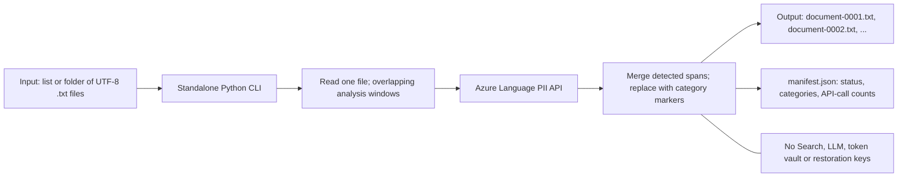
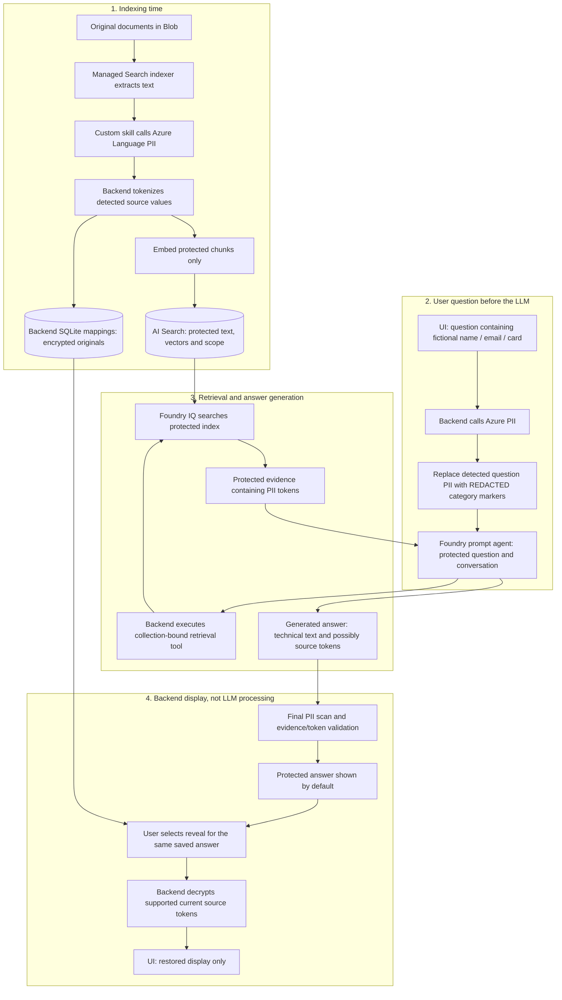
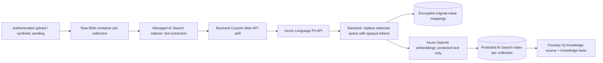
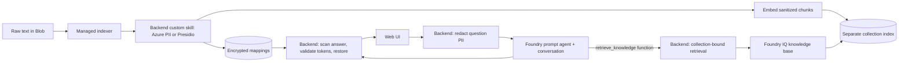

# Two PII demos on Azure

Two separate demos, with no external-party workflow:

1. **Standalone files:** input files -> PII API -> irreversibly de-identified text files. No Search, agent, or restoration mapping.
2. **End-to-end RAG:** Blob -> managed PII skill -> sanitized AI Search -> Foundry IQ/prompt agent -> optional backend restoration.

**Provider:** both default to **Azure Language PII**. Presidio Analyzer API is an alternative adapter, not the provider used in the live Azure validation.

**Live Azure validation completed:** see [results, live UI, network setup, costs, and cleanup](LIVE_TEST.md).

## Start here

| | Demo 1: Multi-file PII | Demo 2: RAG |
|---|---|---|
| Goal | Remove detected PII from a list/folder of files | Answer technical questions over protected documents |
| Entry point | `python -m scripts.anonymize_files` | Hosted web app |
| Processing | Azure Language PII, category replacement | Managed Search indexer/custom skill, PII tokens, embeddings, Foundry IQ, prompt agent |
| Result | Numbered redacted text files + manifest | Grounded answer + evidence + privacy inspector |
| Reversible? | **No mapping created** | Optional evidence-checked backend reveal |
| Needs AI Search? | No | Yes, actual Azure AI Search |
| Needs a model/agent? | No | Yes; no MAF/custom hosted-agent runtime |
| Live retest | 25 November 2026: 8 files, all 16 known identifier canaries absent | 25 November 2026: real Search/IQ/chat/history and browser reveal/hide passed |

**Choose your path:**

- **Just process files:** install dependencies below, configure a Language endpoint, run [Demo 1](#demo-1-standalone-pii-script).
- **Deploy the web app:** install dependencies, sign in, run the single [deployment script](#deploy-demo-2-to-azure), then seed/check the corpus.
- **Demonstrate the existing lab:** open the [live app](https://app-pii-rag-b5a65d.azurewebsites.net), connect with your `RAG_APP_KEY`, and follow [the walkthrough](#see-exactly-what-is-protected).
- **Understand the implementation:** see [architecture](#architecture), [sample files](pii_rag/sample_data), and [live evidence/costs/cleanup](LIVE_TEST.md).

All commands below run from the repository root in PowerShell. Never paste secrets into a command shown in a shared demo or commit `.env`.

## Shared synthetic sample files

[Eight physical input files](pii_rag/sample_data) contain fictional names, street addresses, emails, phone numbers, test credit cards, an example SSN and an example IBAN. They also retain useful incident/policy facts. Both demos consume these same files.

The [evaluation manifest](pii_rag/sample_data/expected_pii.json) lists 16 known identifier canaries and expected technical facts. It is test input, **not** a restoration map or an exported output. Never substitute actual customer data for these examples in source control.

Install once with Python 3.12+:

```powershell
python -m venv .venv
.\.venv\Scripts\python -m pip install -e ".[test]"
```

## Demo 1: standalone PII script

### Flow



Raw input goes to the selected detector. Outputs contain markers such as `[REDACTED_PERSON]` and `[REDACTED_ADDRESS]`; no original-value table accompanies them. The original source files remain on your disk unchanged.

### Run against Azure

Only a reachable Azure Language endpoint and an identity with PII invocation permission are required. No deployed RAG resources, app key, mapping key, or Foundry project is required. `RAG_MODE` has no effect on this script: the default provider is the **real Azure PII API**, not the fixture detector.

```powershell
az login
$env:RAG_LANGUAGE_ENDPOINT = "https://YOUR-LANGUAGE.cognitiveservices.azure.com"
.\.venv\Scripts\python -m scripts.anonymize_files `
  --files .\pii_rag\sample_data\support\INC-104.txt .\pii_rag\sample_data\support\INC-105.txt `
  --output-dir .\.data\demo1-selected
```

Or process all eight files recursively (using the configured endpoint in the environment or `.env`):

```powershell
.\.venv\Scripts\python -m scripts.anonymize_files `
  --input-dir .\pii_rag\sample_data --output-dir .\.data\demo1-all --provider azure
```

Use a **new or empty** output directory each time. The script writes numbered `document-0001.txt` files and a `manifest.json` with provider, status, category counts and API-call counts. Original filenames, entity values, and restoration mappings are not exported. Inputs are left unchanged.

Expected success:

```text
Document 1/8: redacted
...
Document 8/8: redacted
Demo 1 complete: 8 de-identified files in ...
```

Inspect the output files **and** `manifest.json` (`failed` must be `0`). A successful API response is not proof that every possible identifier was detected. In the 25 November live run, outputs were written to ignored `.data\pii-run-20261125`; all 16 known sample canaries were checked, and technical facts remained. See [the dated results](LIVE_TEST.md#25-november-2026-retest).

Example transformation: `Alice Martin reported HTTP 504` -> `[REDACTED_PERSON] reported HTTP 504`. Different people can collapse to the same category marker; preserving identity is not this demo's goal.

- UTF-8 `.txt` only, up to 5 MiB/file; larger text is analyzed in 4,000-character windows with 512-character overlap and merged source spans.
- Files are processed sequentially. A provider/read/encoding failure produces a failed manifest entry and a nonzero exit; no raw-text fallback is written.
- Original text is sent to the selected PII service. The script creates no token vault or decryption key.
- Removing detected PII is **de-identification**, not a guarantee of legal anonymization. Context and false negatives require evaluation/review.

Presidio alternative:

```powershell
.\.venv\Scripts\python -m scripts.anonymize_files `
  --input-dir .\pii_rag\sample_data --output-dir .\.data\demo1-presidio `
  --provider presidio --endpoint http://127.0.0.1:5002
```

Run/deploy Presidio separately; its adapter is contract-tested, not part of the reported live run.

## Demo 2: end-to-end RAG

A lean sample for **technical questions where PII is incidental**:

- Summarize support incidents with names/emails pseudonymized.
- Find similar failure patterns while preserving technical details.
- Explain policies from documents that happen to contain PII.

Not a person search, payment-card lookup, legal anonymization system, or confidential-computing deployment. Identity-specific lookup and document-level RBAC are intentionally out of scope.

### Connect to the hosted UI

The Azure app first shows **Access key required**. This is the expected authentication gate, not a failed Search/model service.

1. Copy the **value** of `RAG_APP_KEY` from your local ignored `.env` or the deployed App Service application settings.
2. Paste it into **Demo application access key**, without surrounding quotes/spaces, and select **Connect**.
3. Collections and chat appear after connection. Do not use `RAG_SKILL_KEY` or an Azure service API key.

The key stays in page memory only; refresh/closing the page requires reconnecting. The UI distinguishes a missing/wrong key from an unavailable service and offers retry for connection failures. No key is embedded in the page or persisted in browser storage.

### See exactly what is protected

1. Open **See what is hidden**. Select a bundled fictional file such as `INC-104`. The original shows example names, billing address, phone, email and test card; the highlighted right-hand text is read from the **actual AI Search index**, not generated as a pretend preview. Only known synthetic fixtures have an original preview; uploaded customer originals are not exposed by this endpoint.
2. Select **Run a PII-visible example**. It submits a real retrieval/generation request asking the agent to quote protected evidence, retaining its opaque placeholders.
3. Check **Show original PII in the latest answer**. The latest displayed answer changes immediately through a backend render endpoint, without a new model call. Uncheck to hide it again. The protected answer/index are not rewritten.

Ordinary technical summaries often include **no PII placeholders**. In that case the checkbox is disabled and the UI explicitly says there is nothing to restore, even though retrieved evidence contains hidden PII. Counts distinguish question masks, indexed-evidence placeholders, answer placeholders, restored values and blocked values.

Not every `[REDACTED]` is reversible: the final answer scan may remove un-tokenized sensitive spans, the model may emit a redaction marker itself, or a token may be unsupported/stale. These are reported separately and are never guessed back into clear values. The inspector shows the backend's protected result, not a raw remote-history export; the final scan can add masks after model generation.

The server retains only the latest protected answer and its evidence permissions for display switching within the existing one-hour conversation lifetime. No restoration maps are downloaded to the browser. Shared demo-key access is still not document-level authorization.

## Architecture

### PII lifecycle: indexing, user questions, retrieval and answers

**Live provider: Azure Language PII.** Presidio is an optional detector adapter, not the
provider used in the live test. The detector finds spans; **our backend** creates the opaque
tokens, encrypts originals, and performs optional restoration. Azure PII does not store a
reversible token dictionary for this application.



Detected **question** PII becomes `[REDACTED_PERSON]` / `[REDACTED_EMAIL]` and has **no
restoration mapping**. **Source** PII becomes `[PII_EMAIL_<opaque-id>]` with an encrypted
mapping, permitting optional display restoration. Retrieval uses technical content, not
identity resolution. The LLM sees protected questions and protected sources; reveal does
not feed originals back into its conversation.

The final scan runs **after** generation: it may add irreversible `[REDACTED]` markers and
cannot erase unexpected PII that the remote model already generated/stored. Detection is
probabilistic. The original source documents still exist in Blob; this is pseudonymization,
not deletion of all originals.

### Where does a token such as `PII_EMAIL_…` point?

It is a backend-generated opaque identifier, **not an encrypted email that the LLM can
decode**, and not a public lookup URL.

| Item | Actual storage in this sample |
|---|---|
| Original source document | Raw Blob container, accessible to the ingestion/backend identities |
| Protected source text + vectors | AI Search, with collection/document-version scope |
| Token-to-original mapping | SQLite `mappings` table: `collection`, `scope`, `token`, encrypted `value` |
| Current document version | SQLite `documents` table; restoration rejects stale mappings |
| Local mapping database | `RAG_DATA_DIR\mappings.sqlite3` (default `.data\mappings.sqlite3`; generated Azure-test configuration uses `.data\azure-test\mappings.sqlite3`) |
| Deployed mapping database | Persistent App Service path `/home/data/pii-rag/mappings.sqlite3` |
| Encryption key | `RAG_MAPPING_KEY`, in ignored local `.env` and deployed App Service settings; not in the index or model prompt |
| Latest answer + evidence references | Backend memory, bound to the conversation and its one-hour lifetime |

Original values are encrypted with **Fernet** before insertion; SQLite's collection/scope/token
metadata is not encrypted. Tokens use a keyed digest scoped to collection/document version
for idempotent retries; they are not cross-document person identifiers. Restoration queries
the mapping only for tokens supported by retrieved evidence and the active collection/version.
Unknown or stale values remain masked. No mapping database is downloaded to the browser.

This is a **single-replica sample**, not a managed SQL/Cosmos deployment. Protect both the
persistent database and key; losing either breaks restoration. For production, move to an
appropriate shared durable store, use managed key protection/rotation and backups, and add
real user/document/reveal authorization. The current shared app key does not supply those policies.

**Demo 1 differs:** the standalone multi-file script writes category-redacted files without
creating this database or a restoration key.

An [editable architecture diagram](architecture.excalidraw) is also included. Open it in
[Microsoft Excalidraw](https://aka.ms/excalidraw).

### RAG ingestion: protect before embedding and indexing



The managed indexer sees raw text during ingestion; the final index and embedding inputs contain the protected representation. The custom skill commits mappings before publishing chunks. Native Blob ACL/RBAC inheritance is **not** enabled.

### RAG conversation: protected reasoning, optional display-only restoration



The prompt agent calls Foundry IQ through a **client-executed function tool**. This is still a Foundry prompt agent, not a local agent or MAF runtime. The wrapper fixes the knowledge base server-side and captures the actual source evidence, so the model cannot choose an index and the renderer can reject unsupported tokens.

Each collection has its own Blob container, indexer, skillset, sanitized index, knowledge source, knowledge base, prompt agent, conversations, and mapping namespace. Service identity privileges can span collections: this is logical routing separation, **not an authorization boundary**.

### What happens when you click reveal?

```mermaid
sequenceDiagram
  participant U as Browser
  participant B as Backend API
  participant A as Foundry prompt agent
  participant K as Foundry IQ / AI Search
  participant V as Encrypted mappings
  U->>B: Question + collection-bound session
  B->>B: Detect/redact question PII
  B->>A: Protected question in conversation
  A->>B: retrieve_knowledge function call
  B->>K: Technical query to fixed collection KB
  K-->>B: Protected evidence + source references
  B-->>A: Protected evidence
  A-->>B: Answer retaining any required opaque tokens
  B->>B: Scan answer; validate tokens against evidence
  B-->>U: Protected answer, counts and answer ID
  U->>B: Reveal same answer ID
  B->>V: Resolve only supported, current, collection-scoped tokens
  V-->>B: Original values
  B-->>U: Restored display answer
  Note over A,K: No new model/retrieval call for reveal or hide
```

### Network and authentication boundaries

- The **lab web UI/API is publicly reachable over HTTPS**, protected by `RAG_APP_KEY`; the key is not a user identity system.
- The deployment script creates **private raw Blob connectivity** for the backend and Search indexer. A public UI does not imply public Blob access.
- The existing Foundry/Language/model endpoints must be reachable from the API/Search environment. This script does not convert an enterprise account to private access.
- `RAG_SKILL_KEY` separately authenticates Search custom-skill calls. Managed identities connect the backend/Search to Azure data services.
- MCP, LiteLLM, confidential computing, per-document permissions, and a fully private enterprise deployment are not part of this sample.

## Run locally (no Azure required)

PowerShell, Python 3.12+:

```powershell
python -m venv .venv
.\.venv\Scripts\python -m pip install -e ".[test]"
.\.venv\Scripts\python -m uvicorn pii_rag.app:app --host 127.0.0.1 --port 8000 --no-access-log
```

Open <http://127.0.0.1:8000>. Run the PII-visible example, inspect the protected evidence, then reveal/hide the latest answer immediately.

If an existing `.env` selects Azure mode, set `$env:RAG_MODE="demo"` in that terminal before starting to force local fixture mode.

**Default mode is a labelled synthetic-only demonstration.** It uses fixture-only PII recognition and lexical extractive retrieval, not Azure, Foundry IQ, an LLM, or meaningful abstractive summarization. Upload is disabled in this mode. It is for checking the protection flow and UI, not measuring real detector/retrieval quality. Never substitute the fixture detector for Azure PII or Presidio.

Alternatively: `docker compose up --build` (Docker required). The Compose app is bound to localhost and uses a persistent demo volume.

## Deploy Demo 2 to Azure

[The deployment script](scripts/deploy_azure.py) creates/reuses an owned sample resource group, Search S1, Linux App Service B1, private Blob Storage, VNet/DNS/private endpoints, managed identities/roles, an isolated Foundry project, the API deployment, Search pipelines and prompt agents.

It reuses an **existing AIServices/Foundry account** with Language PII available and existing `gpt-4o-mini` and `text-embedding-3-small` deployments. It does not create model deployments or increase model quota. You need permission to create resources and role assignments.

### Prerequisites for the single deployment script

1. Python 3.12+, Azure CLI on `PATH`, and the repository dependencies installed as shown above.
2. `az login`; verify the intended subscription with `az account show` and select it with `az account set --subscription <subscription-id>` if necessary.
3. An existing Foundry **AIServices** account in that subscription with reachable Language PII and the two model deployments. An account with only a chat deployment is insufficient.
4. Permission to create Search, App Service, Storage, network/private-DNS resources and the Foundry project; also permission to assign roles at the new resources, the existing Foundry account and project. The script expects an interactive signed-in user for the operator role assignments.
5. Capacity/quota for Search **Standard S1**, one Linux **B1** App Service instance, and supported networking in the selected region.
6. For a new lab, use a fresh checkout or securely back up an existing `.env` pointing to another deployment. Never discard an existing mapping encryption key to bypass a redeployment guard.

### One script deploys the application and infrastructure

```powershell
az login
.\.venv\Scripts\python -m scripts.deploy_azure `
  --resource-group rg-pii-demo `
  --suffix YOURSUFFIX `
  --foundry-resource-group YOUR-FOUNDRY-RG `
  --foundry-account YOUR-FOUNDRY-ACCOUNT `
  --accept-costs
```

**That is the single deployment entry point**; no separate manual ARM, Search JSON, or agent-creation commands are needed. It calls `scripts.provision` internally. It does not install Azure CLI, create your existing Foundry account/model deployments, or upload data automatically.

### Seed and verify after deployment

```powershell
.\.venv\Scripts\python -m scripts.check_azure --seed --timeout 600
```

This separate verification command uploads all eight synthetic files through the deployed API, waits for managed indexing, checks real indexed PII/technical facts and runs actual IQ/agent/history/restoration scenarios. There is no demo-mode fallback. Seeding appends files; subsequent validation normally omits `--seed`:

```powershell
.\.venv\Scripts\python -m scripts.check_azure --timeout 120
```

### What the deployment script does

| Step | Automated action |
|---|---|
| Validate | Check subscription, owned resource-group tag, existing model deployments and `.env` ownership |
| Resources | Create/reuse Search S1, Storage, Linux B1 plan, Python API app and an isolated Foundry project |
| Networking | Configure VNet integration, Blob private endpoint/DNS and approved Search shared private link |
| Identities | Grant the sample app, Search service and signed-in operator their service roles |
| Secrets | Generate keys for a new deployment or preserve existing keys; write ignored `.env` and protected app settings |
| Application | Package allowlisted code/sample files, deploy to App Service, and wait for Azure-mode health |
| Retrieval | Create/update collection containers, managed indexing/PII/embedding pipeline, IQ sources/KBs and prompt agents |

On completion, the script prints the app URL (`https://app-pii-rag-<suffix>.azurewebsites.net`). Open it and use the `RAG_APP_KEY` **value** from generated `.env`. Preserve that file securely for subsequent redeployment/tests; the mapping key is necessary to restore existing tokens.

Replace `YOURSUFFIX` with 6-10 globally unique lowercase letters/digits. Default compute region is Sweden Central; storage defaults to East US 2. Change `--location`/`--storage-location` if quotas or capacity require it. Custom chat/embedding deployment names are supported through CLI options; embeddings use 1536 dimensions.

The script refuses to take over an existing group without the `sample=pii-rag` tag, or overwrite `.env` for a different app. It preserves keys for a redeployment, deploys only an allowlisted source archive, and removes temporary settings/ZIP files automatically. It never prints secrets. `.env` remains locally for access and repeatable tests.

Rerun the same deployment command with the same names to publish code/configuration updates. Existing Search objects are updated and an agent version can be created/reused by the service; this is not a rollback mechanism. A failed operation stops explicitly and can leave partially created billable resources. The tested script rerun reused the existing isolated lab; it does not certify fresh creation in every region/subscription.

**Costs:** the validated S1/B1 setup is about $8.50/day base compute plus private networking, storage and API usage. It remains running until you clean it up. Region quota/permission failures stop explicitly and may leave partial resources; inspect the owned group before rerunning. See [validation and cleanup](LIVE_TEST.md).

### Troubleshooting

| Symptom | Action |
|---|---|
| Access key required / HTTP 401 | Enter `RAG_APP_KEY`, not the skill key or an Azure service key; refresh requires reconnection |
| `az login`/token timeout | Renew CLI login, verify subscription and retry; do not fall back to local demo output |
| Quota or region capacity failure | Choose a supported `--location` with capacity; inspect partial resources before rerunning |
| Blob `AuthorizationFailure` | Check app VNet/private DNS, approved Search private link and Storage data roles; workstation access to private Blob is not expected |
| HTTP 403 after assigning roles | Verify principal/scope and allow role propagation, then retry |
| Sample not indexed yet | Run the seed/check command and inspect indexer status; a queued upload is not yet searchable |
| Reveal checkbox disabled | Latest answer contains no reversible placeholders; use **Run a PII-visible example** |
| Some tokens remain redacted | Check current document versions and mapping persistence; never guess missing originals |
| Existing deployment but local secrets missing | Recover its configuration securely; do not generate a replacement mapping key |

Cleanup is explicit and destructive: follow [the scoped cleanup instructions](LIVE_TEST.md#cleanup-when-finished). Stop/delete the billable resources when finished; stopping only the web app does not stop Search/plan charges. Do not delete the reused Foundry account or its pre-existing deployments.

### Advanced: use resources prepared separately

The lower-level `scripts.provision` command uses existing resources and does not create the underlying billable infrastructure. Neither deployment command runs automatically at application startup.

### Prerequisites

- Azure AI Search, billable tier supporting semantic search/Foundry IQ, semantic ranker enabled, system-assigned managed identity enabled.
- Blob Storage account with managed-identity access.
- Azure Language resource with an Entra-compatible custom endpoint, **or** a reachable Presidio Analyzer API. English text only in this sample.
- Foundry project and a deployed model supporting prompt-agent function calls, e.g. `gpt-4.1-mini`.
- Azure OpenAI embedding deployment (`text-embedding-3-small`, 1536 dimensions by default).
- HTTPS backend endpoint reachable by the managed Search indexer. A localhost URL cannot be used as a cloud custom skill.
- A **single running API replica** with persistent SQLite storage and a stable mapping encryption key. For scale-out, replace the local mapping store and in-memory session registry with shared services.

Typical identity roles:

| Identity | Required access |
|---|---|
| Provisioning user | Search Service Contributor; Storage Blob Data Contributor on sample containers; Foundry project permission to create prompt agents |
| Backend identity / local `az login` user | Search Index Data Reader for retrieval; Search Service Contributor to run/read indexers; Storage Blob Data Contributor for uploads; Foundry project agent/conversation inference access; Cognitive Services User on Language if selected |
| Search managed identity | Storage Blob Data Reader on raw containers; Cognitive Services OpenAI User on the embedding resource |

These are **service connectivity roles**, not per-document RBAC. Restrict resource scopes and ingestion administration. Do not grant the browser direct access to Azure or the mapping database.

### Configure

```powershell
Copy-Item .env.example .env
.\.venv\Scripts\python -c "from cryptography.fernet import Fernet; print(Fernet.generate_key().decode())"
.\.venv\Scripts\python -c "import secrets; print(secrets.token_urlsafe(32)); print(secrets.token_urlsafe(32))"
az login
```

Edit `.env`:

1. Set `RAG_MODE=azure`.
2. Set `RAG_MAPPING_KEY` to the generated Fernet key; set independent `RAG_APP_KEY` and `RAG_SKILL_KEY`.
3. Configure the Search, project, Language, Storage, embedding, and public skill endpoint values.
4. Choose `RAG_PII_PROVIDER=azure` (default) or `presidio`.

The backend runs using `DefaultAzureCredential`: Azure CLI locally, managed identity in Azure. Store deployed secrets in Key Vault/environment secret references, not source control. The local `.env`, keys, and `.data` are ignored by Git.

Start/deploy the API with the same environment and persistent mapping volume. **Do not use the development server as a public production ingress.** Use TLS and authenticated ingress; the app's sample shared key is not a user/tenant identity system. The UI accepts that key and holds it only in memory. The custom skill has a different shared key in `X-Skill-Key`; a future production profile should use Entra authentication for the skill endpoint.

Then configure Search and create prompt agents:

```powershell
.\.venv\Scripts\python -m scripts.provision --seed
```

This creates/updates only resources named `pii-support-*` and `pii-policies-*` on your configured services, and creates a new prompt-agent version. Review existing objects with these names before running: re-provisioning intentionally updates them.

The script configures:

- Managed Blob indexer -> custom PII skill -> sanitized chunks -> embedding skill.
- Child-only index projections (no raw parent content indexed).
- A sanitized-index knowledge source and extractive Foundry IQ knowledge base per collection.
- A prompt agent with system instructions and the single `retrieve_knowledge` function.
- Optional synthetic seed files in the collection containers.

For private-only Blob Storage, prepare containers through ARM, configure App Service VNet integration/private Blob DNS and an approved Search shared private link, then run `scripts.provision --skip-storage --private-indexer`. Private custom-skill execution requires S1 or higher; Basic is not the tier used by the validated private deployment. Seed through the hosted upload API, not the workstation's blocked Blob route. See [the validated private topology](LIVE_TEST.md).

The knowledge base uses **minimal reasoning**: the prompt agent formulates technical queries; Foundry IQ retrieves evidence. This avoids an additional planner model/deployment in the lean version. Increase retrieval reasoning later if measured quality warrants it.

Check ingestion status in the UI before querying. If the indexer is already running, the app explicitly reports that the uploaded file is awaiting the next scheduled run rather than pretending it is already indexed.

### Presidio option

For local API testing with a locally running backend:

```powershell
docker compose --profile presidio up -d presidio
```

Set `RAG_PII_PROVIDER=presidio` and `RAG_PRESIDIO_ENDPOINT=http://127.0.0.1:5002`. For an Azure-hosted backend, deploy Presidio where that backend can reach it over protected networking; localhost on the backend host is not your workstation.

Provider selection is server configuration, not a model argument. Restart and reingest/reindex after changing provider or policy. Both providers use the **same backend mapping renderer** for restoration. Azure PII has no inverse operation; Presidio decryption is not needed for this token-vault pattern. Pin and approve the Presidio image version for real deployments; Compose's optional `latest` image is a development convenience.

## Question and history protection

### Concrete questions and expected answers

**Yes: both document PII and detected question PII are protected before model use.**
The question's redactions are irreversible category markers. Document PII uses separate,
reversible opaque tokens. These are different mechanisms; the app does not match people
by their name or recover a removed question value from a category marker.

The UI now provides collection-specific **fictional PII question buttons**, with an expected
effect for each. Click one, then **Ask collection**. Compare **Your question as typed**
with **Question sent to agent** in the inspector.

| Demonstration | Type this question | Expected protected representation / answer |
|---|---|---|
| Question name/email masking | `Alice Martin (alice@example.test) reported checkout HTTP 504. What technical causes and fixes are documented? Do not identify the person.` | Agent receives `[REDACTED_PERSON] ([REDACTED_EMAIL]) ... HTTP 504 ...`. A grounded technical answer discusses connection-pool rollback/concurrency without needing personal identifiers. |
| Question card masking **and** answer tokens | `My test card is 4111111111111111; checkout returned HTTP 429. Quote the full matching incident evidence verbatim, preserving every opaque placeholder exactly. Do not infer original identifiers.` | Question card becomes a category marker. Quoted **source** evidence can contain `Customer name: [PII_PERSON_…]. Email: [PII_EMAIL_…]. ... card: [PII_CREDITCARDNUMBER_…]`. Reveal substitutes the fictional originals only in the answer display. |
| Visible masked password-reset answer | `Quote the full password-reset mail queue incident evidence verbatim, including its reported details. Preserve every opaque placeholder exactly. Do not infer original identifiers.` | Quoted evidence contains `[PII_PERSON_…] ([PII_EMAIL_…]) reported the issue ...`. Reveal can show `Clara Jones (clara@example.test)`, from the retrieved source mapping, not from the question. |
| Policies collection | `Quote the checkout incident documentation policy evidence verbatim, including its synthetic contact sentence. Preserve every opaque placeholder exactly. Do not infer original identifiers.` | The policy contact sentence stays tokenized until reveal. Use **Service policies**, not the support collection. |

These are illustrative shapes, **not fixed LLM response snapshots**. Entity category names,
extra detections (for example PersonType), source ordering, and wording can differ. The app
never manufactures a masked answer when the model omits identifiers. For an ordinary summary
with zero answer placeholders, reveal is correctly unavailable.

The as-typed question is shown in browser memory only by the UI; the backend receives it for
PII detection and submits only the protected version to the agent. Do not interpret that UI
preview as content sent to the model. Detection can miss values, so this is not an absolute
guarantee that arbitrary PII will never reach a model.

The lean version does **not** implement identity resolution.

`Alice Martin saw HTTP 504 at checkout. What usually fixes that?`

becomes:

`[REDACTED_PERSON] saw HTTP 504 at checkout. What usually fixes that?`

The agent searches the technical subject, not an opaque person token. Known names are not joined across documents. Questions that require identifying a person or card are unsupported; use a structured lookup in a future version.

Only the protected message is appended to the Foundry conversation. Agent responses and retrieved excerpts remain pseudonymized there. The restored display answer is a **separate backend transformation**, never another user/assistant message. Follow-ups use Foundry conversation state; the browser never replays its clear-text transcript. Changing collection deletes the old remote conversation when possible and starts a fresh, collection-bound session.

The backend runs up to four function-call rounds per turn, validates tool arguments, scans generated tool queries, checks evidence collection metadata, rescans the final answer, and restores only exact token references present in current-turn evidence with a current local document version. Unknown/cross-collection/stale tokens remain redacted with a visible warning.

Important limitations:

- PII detectors are probabilistic; neither provider guarantees complete removal. Context can identify someone even after names are removed.
- A generated answer can be stored in Foundry before the backend's final leakage scan. The scan limits display exposure; it does not retroactively erase model output from remote conversation state.
- Token provenance checks do not prove every factual relationship in a generated answer is correct. Evaluate grounding and citations.
- Current-turn evidence is required for restoration, even if a token appeared in an earlier turn.
- The restore toggle is not authorization. This sample assumes a uniformly shareable collection.

## Lean boundaries

- English `.txt`, at most **4,000 Unicode code points per document** and 2,000 per question. Reject oversized files instead of silently truncating. No PDF, OCR, attachments, or raw images.
- Answers over 4,000 characters fail explicitly rather than skipping the leakage scan.
- Uploads are append-only under random names. Source editing/deletion/retention cleanup is **not automated**; do not mutate/delete indexed blobs outside this workflow and assume old Search content disappears. To retire a corpus, remove its index, remote conversations, mappings, and raw blobs through a controlled administrative process.
- SQLite encrypts original mapping values with Fernet; collection/scope/token metadata is not encrypted. A keyed digest provides stable tokens for retries within document version, not cross-document identity.
- Local application sessions are memory-only, expire after one hour, and are limited to 100. Restarting loses those bindings; remote abandoned conversations need administrative retention cleanup.
- One API replica/worker. Keep the mapping key and data together persistently; losing the key makes restoration impossible. Backup/rotation and distributed session storage are future work.
- Indexer warnings/errors are counted in the UI but raw diagnostics are not exposed because they may contain source text. Restrict Azure debug sessions, enrichment caches, traces, and ingestion-admin access.
- Existing Search-index migration, fine-grained ACLs, formal accuracy benchmarks, and infrastructure-as-code deployment are deferred. Reingest from source for this first slice.
- No automatic fallback from a failed Azure/provider call to demo output.

## Validate

```powershell
.\.venv\Scripts\python -m pytest -q
.\.venv\Scripts\python -m ruff check .
.\.venv\Scripts\python -m pyright
node --check .\pii_rag\static\app.js
```

Tests cover encrypted round trips, question redaction with technical-term preservation, collection separation, stale/forged tokens, provider failures, custom-skill errors, safe projections/embedding inputs, and HTTP/UI integration. Mocked Azure contract tests are **not a live Azure deployment test**.

For an explicitly configured real deployment, run `python -m scripts.check_azure` (or add `--seed` to append synthetic fixtures). This uses the live API, real indexers, Azure PII, Foundry IQ, prompt agents, and remote conversation-item inspection; it never falls back to demo output. See [live validation details](LIVE_TEST.md).

Optional browser regression (Node 22+ and Microsoft Edge, testing the deployed UI using ignored `.env`):

```powershell
npm install --prefix .data\ui-browser-deps playwright
$env:NODE_PATH = (Resolve-Path .data\ui-browser-deps\node_modules).Path
node .\tests\check_ui.cjs --live
```

Without `--live`, the same test uses controlled failure fixtures against a local app on port 8766 (`UI_TEST_URL` can override). It covers missing/wrong/valid keys, HTML service errors/retry, and a failed conversation reset without reusing the old collection's session. Browser tools are optional test dependencies, not part of the application build.

For real quality evaluation, run the same synthetic technical questions against raw reference and protected indexes. Compare retrieval recall@k, grounded answer quality, retained error codes/remediation facts, PII detection recall/precision, and latency. Do not infer preserved relevance just because a token round-trips correctly.

## Key files and documentation

- [Backend](pii_rag/app.py), [PII adapters and mappings](pii_rag/pii.py), [prompt agent](pii_rag/agent.py), [retrieval](pii_rag/knowledge.py).
- [Search/agent setup](scripts/provision.py), [UI](pii_rag/static/index.html), [design](DESIGN.md).
- [Foundry prompt-agent function calling](https://learn.microsoft.com/azure/foundry/agents/how-to/tools/function-calling).
- [Foundry IQ retrieval](https://learn.microsoft.com/azure/search/agentic-retrieval-how-to-retrieve).
- [Azure Language PII](https://learn.microsoft.com/azure/ai-services/language-service/personally-identifiable-information/how-to/redact-text-pii).
- [Custom Web API skill](https://learn.microsoft.com/azure/search/cognitive-search-custom-skill-web-api).
